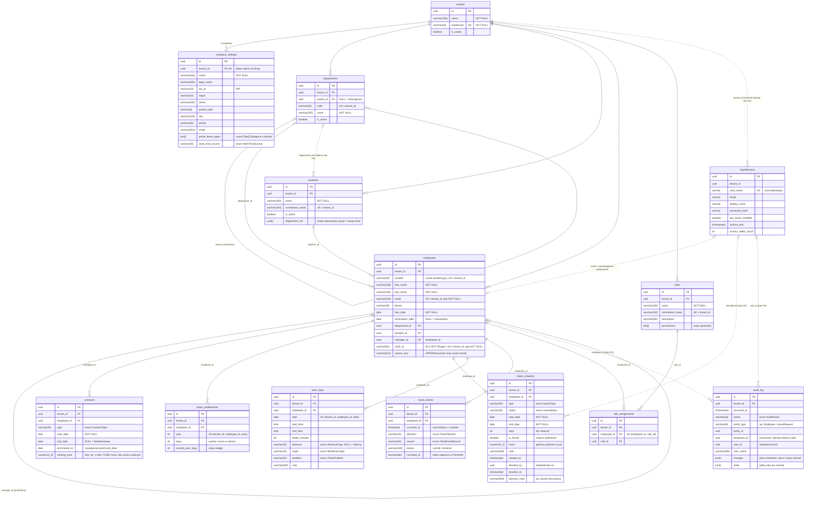

# PersoNet – model bazy danych (ERD)

Opis struktury bazy PostgreSQL przygotowany tak, żeby czytał go zarówno człowiek, jak i model AI.
Źródło prawdy: `src/Infrastructure/PersoNet.Infrastructure/Persistence/Migrations/PersoNetDbContextModelSnapshot.cs`
(schemat `public`) i `src/Hosts/PersoNet.Identity/Data/Migrations/IdentityDbContextModelSnapshot.cs` (schemat `identity`).
Po każdej migracji zmieniającej tabele zaktualizuj ten plik.

## Zasady obowiązujące wszystkie tabele

- **Multi-tenant.** Każda tabela poza `tenants` ma kolumnę `tenant_id uuid NOT NULL` z FK do `tenants.id`
  i indeksem. Dane jednej firmy (tenanta) nigdy nie mieszają się z innymi.
- **Row-Level Security.** Na każdej tabeli z `tenant_id` działa polityka `tenant_isolation`:
  wiersz jest widoczny tylko, gdy `tenant_id = current_setting('personet.tenant_id')::uuid`.
  Ustawienie wpisuje `TenantSessionInterceptor` przy otwarciu połączenia. EF Core dodatkowo filtruje po tenancie.
- **Klucze.** Wszystkie PK to `id uuid` generowane w aplikacji (nie w bazie).
- **Nazewnictwo.** snake_case: tabele w liczbie mnogiej, `pk_<tabela>`, `fk_<tabela>_<tabela_docelowa>_<kolumna>`,
  `ix_<tabela>_<kolumny>`.
- **Usuwanie.** Wszystkie FK mają `ON DELETE RESTRICT`; nic nie kasuje się kaskadowo.
- **Enumy** są zapisywane jako tekst (nazwa wartości, np. `Approved`), nie jako liczby. Lista wartości niżej.
- **Daty.** `date` = `DateOnly`, `timestamptz` = `DateTimeOffset` (UTC), `timestamp` (bez strefy) = czas lokalny
  z czytnika RCP.

## Diagram

## Tabele – krótki opis

| Tabela | Moduł | Co przechowuje |
|---|---|---|
| `tenants` | Tenancy | Firma (klient SaaS). Jedyna tabela bez `tenant_id` i bez RLS. |
| `company_settings` | Firma | Dane firmy i ustawienia (jeden wiersz na tenanta): NIP, REGON, adres, rodzaje urlopów w portalu, źródło czasu pracy. |
| `departments` | Struktura | Drzewo działów (`parent_id` → ten sam stół). |
| `positions` | Struktura | Słownik stanowisk wspólny dla całej firmy, niezależny od działów. |
| `employees` | Kadry | Kartoteka pracownika; dział, stanowisko i przełożony są przypisane tutaj. |
| `contracts` | Kadry | Umowy pracownika (historia, jeden pracownik ma wiele umów). |
| `leave_entitlements` | Urlopy | Roczny wymiar urlopu pracownika (dni + zaległe). 1 dzień = 8 h. |
| `leave_requests` | Urlopy | Wnioski urlopowe i ich decyzje. |
| `work_days` | Czas pracy | Dzień pracy pracownika (wejście, wyjście, przerwa, nieobecność) – wynik ręczny albo wyliczony z odbić. |
| `clock_events` | Czas pracy | Surowe odbicia RCP (wejście/wyjście), z ręki, z pliku lub z integracji (Roger PR Master). |
| `roles` | Uprawnienia | Role z listą kodów uprawnień. |
| `role_assignments` | Uprawnienia | Przypisanie ról pracownikom (N:M employees ↔ roles). |
| `audit_log` | Audyt | Historia zmian encji (kto, kiedy, co) – zapisywana automatycznie przy `SaveChanges`. |
| `identity.AspNetUsers` | Logowanie | Konta logowania (ASP.NET Identity + OpenIddict) w osobnym schemacie i osobnym `DbContext`. |

## Powiązania, których nie widać w kluczach obcych

- **Konto ↔ pracownik**: `identity.AspNetUsers.email` = `employees.email` w tym samym `tenant_id`
  (porównanie bez wielkości liter). Nie ma kolumny `user_id` w `employees`.
- `leave_requests.decided_by`, `audit_log.user_id` → `identity.AspNetUsers.id` (inny `DbContext`, brak FK).
- `audit_log.entity_type` + `entity_id` → dowolna tabela (polimorficzne odwołanie); `audit_log.employee_id`
  pozwala pokazać całą historię na karcie pracownika.
- `clock_events` → `work_days`: dni z `origin = Clock` są wyliczane z odbić tego samego pracownika i dnia.
- `employees.clock_id` = identyfikator pracownika w systemie RCP; po nim import odbić znajduje pracownika.

## Wartości enumów (zapisywane jako tekst)

| Kolumna | Wartości |
|---|---|
| `contracts.type` (ContractType) | `Probation` (na okres próbny), `FixedTerm` (na czas określony), `Indefinite` (na czas nieokreślony), `Mandate` (zlecenie), `SpecificWork` (o dzieło), `B2B` |
| `leave_requests.type` (LeaveType) | `Annual` (wypoczynkowy), `OnDemand` (na żądanie, max 4 dni), `Occasional` (okolicznościowy), `Unpaid` (bezpłatny), `ChildCare` (opieka nad dzieckiem, art. 188 KP), `ForceMajeure` (siła wyższa, art. 148¹ KP) |
| `leave_requests.status` (LeaveStatus) | `Pending`, `Approved`, `Rejected`, `Cancelled` |
| `company_settings.work_time_source` (WorkTimeSource) | `Manual`, `FileImport`, `RogerPrMaster`, `Api` |
| `work_days.absence` (AbsenceType) | `Sickness` (L4), `CareAllowance` (zasiłek opiekuńczy), `Excused` (usprawiedliwiona), `Unexcused` (nieusprawiedliwiona) |
| `work_days.origin` (WorkDayOrigin) | `Manual`, `Clock` |
| `work_days.problem` (ClockProblem) | `None`, `MissingOut`, `MissingIn`, `TooLong` |
| `clock_events.direction` (ClockDirection) | `In`, `Out` |
| `clock_events.source` (ClockEventSource) | `Manual`, `File`, `Integration` |
| `audit_log.action` (AuditAction) | `Created`, `Changed`, `Deleted` |
| `roles.permissions` (kody) | `organization.manage`, `employees.read`, `employees.manage`, `leave.read`, `leave.manage`, `accounts.manage`, `audit.read`, `roles.manage`, `settings.manage`, `reports.read`, `worktime.read`, `worktime.manage` |

## Indeksy unikalne (reguły biznesowe w bazie)

- `tenants(subdomain)`
- `company_settings(tenant_id)` – jeden wiersz ustawień na firmę
- `departments(tenant_id, code)`, `positions(tenant_id, normalized_name)`, `roles(tenant_id, normalized_name)`
- `employees(tenant_id, number)`; `employees(tenant_id, email) WHERE email IS NOT NULL`;
  `employees(tenant_id, clock_id) WHERE clock_id IS NOT NULL`
- `leave_entitlements(tenant_id, employee_id, year)`
- `work_days(tenant_id, employee_id, date)` – jeden dzień pracy na pracownika i datę
- `clock_events(tenant_id, employee_id, occurred_at, direction)` – ten sam import nie dubluje odbić
- `role_assignments(employee_id, role_id)`

Tabele OpenIddict (`OpenIddictApplications`, `OpenIddictAuthorizations`, `OpenIddictScopes`, `OpenIddictTokens`)
i pozostałe tabele ASP.NET Identity (`AspNetRoles`, `AspNetUserRoles`, `AspNetUserClaims`, …) w schemacie `identity`
są standardowe i pominięte na diagramie.
