# Stara baza „Kadry” (MySQL) – model danych (ERD)

Opis bazy MySQL/MariaDB, z której PersoNet przejmuje dane. Napisany dla ludzi i dla modeli AI, które piszą import
albo mapowanie do nowego modelu (`docs/database/erd.md`).
Źródło: zrzuty HeidiSQL `table-*.sql`, `procedure-*.sql`, `function-*.sql`, `trigger-*.sql`
(kopia w folderze projektu `legacy-db/`). Schemat `Employees` pochodzi z fixture testu importu
(`tests/PersoNet.Desktop.Presentation.Tests/EmployeeImportTests.cs`), który odwzorowuje prawdziwy zrzut.

## Najważniejsze pułapki

- **Prawie nie ma kluczy obcych.** Tylko `EmployeeSchools`, `PriorEmployments` i `accidents` mają `FOREIGN KEY`.
  Reszta powiązań wynika z nazw kolumn i z procedur – na diagramie są liniami przerywanymi.
- **Dwa pokolenia tabel.** Nowsze, po angielsku, InnoDB (`Employees`, `EmploymentHistory`, `Departments`, …)
  i starsze, po polsku, MyISAM (`obecnosc`, `absencja`, `szkolenia_*`, `badania`, `grupy`, `wydzialy`).
  Wszystkie wskazują na ten sam identyfikator pracownika: `Employees.EmployeeID`
  (`idprac`, `idPrac`, `id_employee`, `EmployeeID`). Jeszcze starsza tabela `pracownik` (nie ma jej w zrzucie)
  jest używana przez `SF_getEmployeeStatus` i `user_GetData` (kolumny `id`, `dataZ`, `status`, `adlogin`).
- **Daty jako liczby Excela.** `obecnosc.dzien`, `badania.data_badania`/`wygasa`, `szkolenia*.data`/`wygasa`
  to liczba dni od `1899-12-30` (`DATE_ADD('1899-12-30', INTERVAL x DAY)`). `obecnosc.od`/`do`/`data`/`edit_data`
  to data i godzina Excela (część całkowita = dzień, ułamek = pora dnia, np. `40462.25` = 2010-10-10 06:00).
- **Daty zerowe.** W kolumnach `date` występuje `'0000-00-00'` (np. `absencja.dzien_do`, `Employees.HireDate`)
  i `'1899-12-30'` jako „brak daty” (`Employees.BirthDate`). Traktuj obie jako NULL.
- **Flagi jako `int(2)`/`tinyint`** (0/1), czasem z więcej niż dwiema wartościami (`grupy.czy_matryca` = 0/1/2).
- **Firma przez dział.** Raporty KPI rozróżniają spółki po `wydzialy`: `Departments.DepartmentType = 5` („Prima”)
  to druga spółka, reszta to spółka główna. `EmploymentHistory.CompanyID` → `Companies` oznacza pracodawcę
  (własny lub agencja pracy tymczasowej, `IsTemporaryEmployee = 1`).

## Diagram

Linia ciągła = FK w bazie, przerywana = powiązanie wywnioskowane (brak FK).

```mermaid
erDiagram
    EmployeeStatuses ||..o{ Employees : "StatusID"
    Departments |o..o{ Employees : "DepartmentID (bieżący)"
    Positions |o..o{ Employees : "PositionID (bieżące)"

    Employees ||..o{ EmploymentHistory : "EmployeeID"
    Departments ||..o{ EmploymentHistory : "DepartmentID"
    Positions ||..o{ EmploymentHistory : "PositionID"
    JobCategories ||..o{ EmploymentHistory : "JobCategoryID"
    Companies ||..o{ EmploymentHistory : "CompanyID"
    Departments ||..o{ Positions : "DepartmentID"
    wydzialy ||..o{ Departments : "DepartmentType"

    Employees ||--o{ PriorEmployments : "EmployeeID (FK)"
    Employees ||--o{ EmployeeSchools : "EmployeeID (FK)"
    SchoolTypes ||--o{ EmployeeSchools : "SchoolID (FK)"

    Employees ||..o{ obecnosc : "idprac"
    grupy |o..o{ obecnosc : "grupa = nazwa (tekst)"
    Employees ||..o{ absencja : "idPrac"
    urlopy_typy ||..o{ absencja : "idAbsencja"
    Employees ||..o{ zarzadzanie_godzinami : "idPrac"
    zarzadzanie_godzinami ||..o{ rozliczone_dni : "id_zarzadzanie_godzinami"

    Employees ||..o{ accidents : "id_employee"
    severity_levels ||--o{ accidents : "id_severity (FK)"
    accidents ||..o{ accident_absences : "id_accident"
    absencja ||..o{ accident_absences : "id_absence"

    Employees ||..o{ badania : "idprac"
    Employees ||..o{ szkolenia_prac : "idprac"
    szkolenia_definicje ||..o{ szkolenia_prac : "idszkolenia"
    szkolenia_definicje ||..o{ szkolenia : "idszkolenia (stara kopia)"
    szkolenia_definicje ||..o{ szkolenia_rel : "id_szkolenia"
    wydzialy |o..o{ szkolenia_rel : "id_wydzialu (0 = brak)"
    grupy |o..o{ szkolenia_rel : "id_grupy (0 = brak)"
    wydzialy ||..o{ grupy : "id_wydzial"
    Employees ||..o{ EmployeeTraining : "EmployeeID"

    Employees {
        int EmployeeID PK
        varchar(50) FirstName
        varchar(50) LastName
        enum Gender "Mężczyzna | Kobieta"
        date BirthDate "1899-12-30 = brak"
        date HireDate "bywa 0000-00-00"
        date TerminationDate "NULL = zatrudniony"
        varchar(20) PhoneNumber
        int StatusID "→ EmployeeStatuses"
        int PositionID "→ Positions"
        int DepartmentID "→ Departments"
        int UrlopR "roczny wymiar urlopu (dni)"
    }
    EmployeeStatuses {
        int StatusID PK "1 Aktywny, 2 Zwolniony"
        varchar(50) StatusName UK
    }
    EmploymentHistory {
        int HistoryID PK
        int EmployeeID
        int DepartmentID
        int PositionID
        date StartDate
        date EndDate "NULL = trwa"
        int Workload "godziny dziennie, domyślnie 8"
        int IsDisability "0/1 niepełnosprawność"
        int JobCategoryID
        int Irregular_hours "0/1 nienormowany czas"
        int IsManager "0/1"
        int CompanyID "→ Companies, domyślnie 1"
    }
    Departments {
        int DepartmentID PK
        varchar(100) DepartmentName UK
        int DepartmentType "→ wydzialy.id"
    }
    Positions {
        int PositionID PK
        varchar(100) PositionName
        int DepartmentID
    }
    JobCategories {
        int JobCategoryID PK
        varchar(50) Name "Biurowa, Produkcyjna, …"
    }
    Companies {
        int CompanyID PK
        varchar(50) CompanyName
        int IsTemporaryEmployee "1 = agencja pracy tymczasowej"
    }
    PriorEmployments {
        int PriorEmploymentID PK
        int EmployeeID FK
        date StartDate
        date EndDate
    }
    EmployeeSchools {
        int EmployeeSchoolID PK
        int EmployeeID FK
        int SchoolID FK
        date StartDate
        date EndDate
    }
    SchoolTypes {
        int SchoolID PK
        varchar(200) SchoolType
        int DaysCount "dni wliczane do stażu"
    }
    wydzialy {
        int id PK
        varchar(100) nazwa "PVC, Aluminium, Biuro, Prima, …"
        varchar(250) opis
    }
    grupy {
        int id PK
        int kolejnosc
        varchar(50) nazwa "zwykle = Departments.DepartmentName"
        varchar(50) wydzial "nazwa wydziału (tekst)"
        int id_wydzial
        int czy_matryca
        decimal poziom1 "premie"
        decimal poziom2
        decimal poziom3
        decimal licz_absencje
        decimal licz_jakosc
        decimal licz_bhp
        tinyint globalne_premie
    }
    obecnosc {
        int id PK
        int idprac
        int dzien "data Excela"
        decimal od "data+godzina Excela, wejście"
        decimal do "data+godzina Excela, wyjście"
        varchar(5) inne "kod dnia: ZP, BAD, DEL, SZK, TAR, …"
        int razem "minuty pracy"
        varchar(50) user "kto dodał"
        decimal data "kiedy dodał (Excel)"
        varchar(50) edit_user
        decimal edit_data
        varchar(10) wejscie
        varchar(10) wyjscie
        varchar(60) grupa "nazwa grupy/działu (tekst)"
        int firma
    }
    absencja {
        int id PK
        int idPrac
        int idAbsencja "→ urlopy_typy"
        date dzien_od
        date dzien_do "bywa 0000-00-00"
        int wymiar
        int idStatus "2 zaplanowana, 4 trwa, 5 zakończona"
    }
    urlopy_typy {
        int id PK "brak w zrzucie"
        int czy_liczy_dni "0/1 urlop, 3 ?, 4 chorobowe"
        int czy_liczy_kpifr "1 = liczy się do absencji KPI"
    }
    zarzadzanie_godzinami {
        int id PK "brak w zrzucie"
        int idPrac
        date data
        enum typ "Urlop | Nadgodziny"
        varchar(255) opis
        tinyint czy_rozliczone
        varchar(50) updated_by
        datetime updated_at "ustawia trigger"
    }
    rozliczone_dni {
        int id PK "brak w zrzucie"
        int id_zarzadzanie_godzinami
        date data_rozliczenia
        decimal godziny_rozliczone
    }
    accidents {
        int id PK
        int id_employee
        int id_severity FK
        date accident_date
        varchar(50) location
        varchar(255) description
        tinyint is_accident "1 wypadek, 0 zdarzenie potencjalnie wypadkowe"
        datetime created_at
        varchar(50) created_by "login"
    }
    severity_levels {
        int id PK "brak w zrzucie"
    }
    accident_absences {
        int id PK
        int id_accident
        int id_absence "→ absencja.id"
    }
    badania {
        int id PK
        int idprac
        int data_badania "data Excela"
        int wygasa "data Excela"
        tinyint czy_aktywne
        varchar(250) uwagi
    }
    szkolenia_definicje {
        int id PK
        varchar(50) nazwa
        varchar(50) waznosc "dni ważności jako tekst"
        int czy_wygasa
        int czy_obowiazkowe
        int czy_punkty
        int czy_wydzialy "przypisane do wydziałów"
        int czy_grupy "przypisane do grup"
        varchar(500) opis
        varchar(50) user
    }
    szkolenia_prac {
        int id PK
        int idszkolenia
        int idprac
        int data "data Excela"
        int wygasa "data Excela"
        tinyint czy_aktywne
        varchar(250) uwagi
        int pretest
        int posttest
        int poprawka
        int poprawka2
    }
    szkolenia {
        int id PK "starsza kopia szkolenia_prac"
    }
    szkolenia_rel {
        int id PK
        int id_szkolenia
        int id_wydzialu
        int id_grupy
    }
    EmployeeTraining {
        int ID PK
        int TrainingID "cel niepewny"
        int EmployeeID
        date TrainingDate
        date ExpirationDate
        varchar(50) Description
        varchar(50) createdBy
        datetime createdAt
    }
```

## Tabele

| Tabela | Silnik | Co przechowuje | Odpowiednik w PersoNet |
|---|---|---|---|
| `Employees` | InnoDB | Kartoteka pracownika. | `employees` (import już działa: `EmployeeID` → `number`, `UrlopR` → `leave_entitlements.days`) |
| `EmployeeStatuses` | InnoDB | Słownik: Aktywny / Zwolniony. | wynika z `termination_date` |
| `EmploymentHistory` | InnoDB | Historia zatrudnienia: dział, stanowisko, wymiar, kategoria, pracodawca w okresie. | `contracts` + przypisanie działu/stanowiska (brak historii w PersoNet) |
| `Departments` | InnoDB | Działy (płaska lista). | `departments` (wydział → dział nadrzędny) |
| `wydzialy` | MyISAM | Wydziały, czyli grupy działów; jeden oznacza drugą spółkę. | `departments` z `parent_id = NULL` |
| `Positions` | InnoDB | Stanowiska przypięte do działu. | `positions` (`department_ids`; 0 = każdy dział) |
| `JobCategories` | InnoDB | Kategoria pracy (biurowa, produkcyjna, …). | brak |
| `Companies` | InnoDB | Pracodawca: spółka albo agencja pracy tymczasowej. | brak |
| `PriorEmployments`, `EmployeeSchools`, `SchoolTypes` | InnoDB | Staż pracy: wcześniejsze zatrudnienia i szkoły (do wymiaru urlopu). | brak |
| `obecnosc` | MyISAM | Obecności dzienne (~1 mln wierszy): wejście, wyjście, minuty, kod dnia. | `work_days` |
| `absencja` | MyISAM | Nieobecności i urlopy w okresach od–do; kod `R` to roczny wymiar urlopu (suma wpisów z 1 stycznia, wpisy ze statusem 2 to zaległy). | `leave_requests` (urlopy, zatwierdzone), `absences` (L4, delegacje, HO itd.), `leave_entitlements` (`R`) |
| `urlopy_typy` | InnoDB | Słownik rodzajów nieobecności (`nazwa_skrot`: U, UB, UM, UOK, UOP, UNŻ, UON, UOŚ, HO, UOJ, URODZ, UWYCH, SW, R, CH, CHOPD, CHOP, ZRH, CHW, NN, DEL, SZK, BAD, IN, TAR, ZP). | `LeaveType` / `Absences.AbsenceType` po skrócie |
| `zarzadzanie_godzinami`, `rozliczone_dni` | ? | Nadgodziny i godziny urlopu do odbioru oraz ich rozliczenie (brak w zrzucie). | brak |
| `accidents`, `accident_absences`, `severity_levels` | InnoDB | Wypadki przy pracy i powiązane nieobecności. | brak |
| `badania` | MyISAM | Badania lekarskie (data, ważność). | brak |
| `szkolenia_definicje`, `szkolenia_prac`, `szkolenia_rel`, `szkolenia` | MyISAM | Szkolenia: definicje, odbyte szkolenia pracowników, przypisanie do wydziałów/grup. | brak |
| `EmployeeTraining` | InnoDB | Nowsza tabela szkoleń, w zrzucie pusta. | brak |
| `grupy` | MyISAM | Grupy produkcyjne z parametrami premii; nazwy pokrywają się z działami. | brak |

Tabele pomocnicze używane przez procedury, ale nieobecne w zrzucie: `UstawowoWolne` (dni ustawowo wolne, kolumna `data`),
`liczby` (generator liczb `n`), `pracownik` (najstarsza kartoteka).

## Procedury i funkcje

- `SF_GetEmployeeStatus2(idPrac)` – „Zwolniony”, „Chorobowe” (`urlopy_typy.czy_liczy_dni = 4`) albo „Urlop” (0/1) na dziś.
- `function_getUrlop(d1, d2)` – liczba dni roboczych (pn–pt bez `UstawowoWolne`).
- `KPIFr_AbsenteeismRate`, `KPIFr_Employees` – miesięczne KPI dla spółki: godziny pracy z `obecnosc`, absencje,
  wypadki, liczba pracowników wg płci, tymczasowi, kierownicy.
- `SP_UpdateLeaveStatus` – przestawia `absencja.idStatus` 2 → 4 (trwa) → 5 (zakończona).
- `SP_*ZarzadzanieGodzinami`, `SP_*RozliczoneDni`, `SP_SummaryHours` – nadgodziny i godziny urlopu do rozliczenia.
- `SP_GetSzkolenia(idprac)` – szkolenia pracownika z datą ważności.
